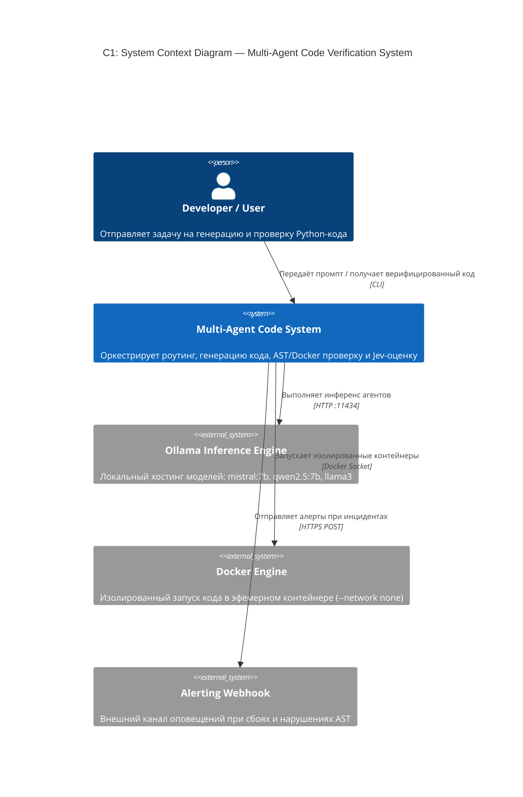
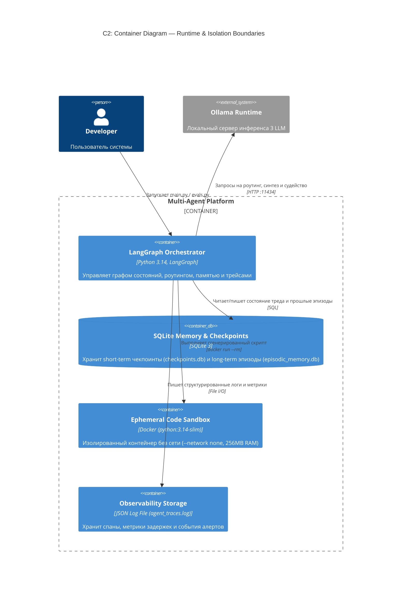
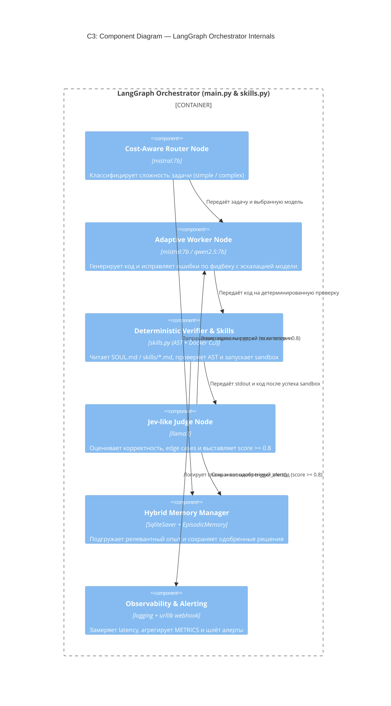
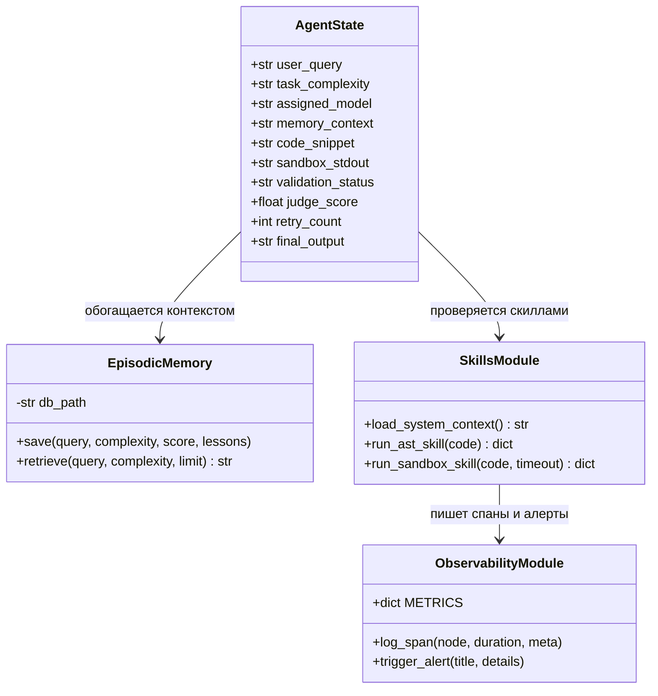
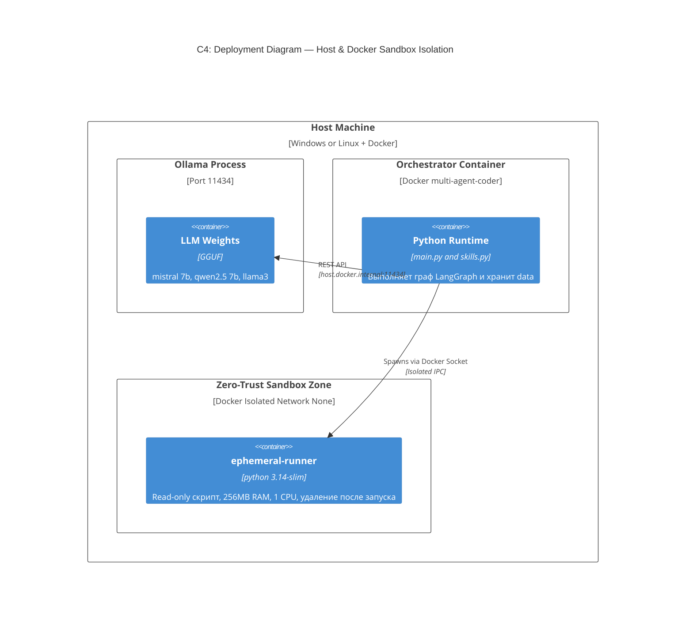
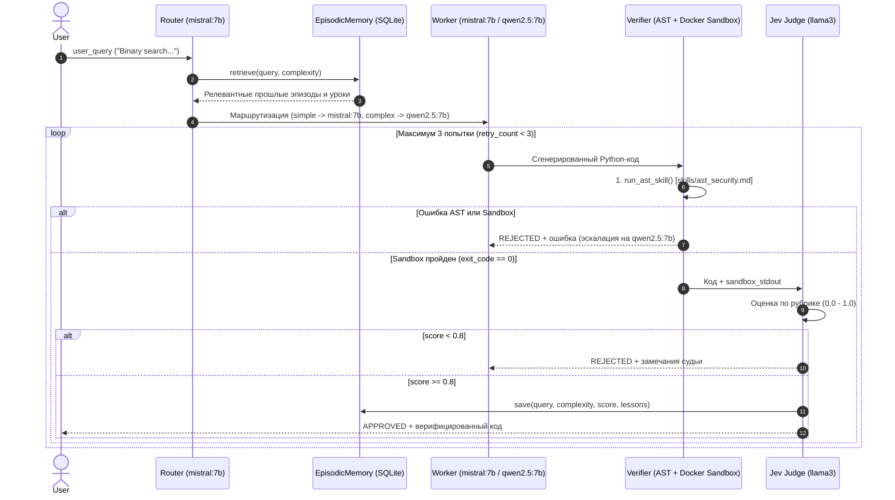
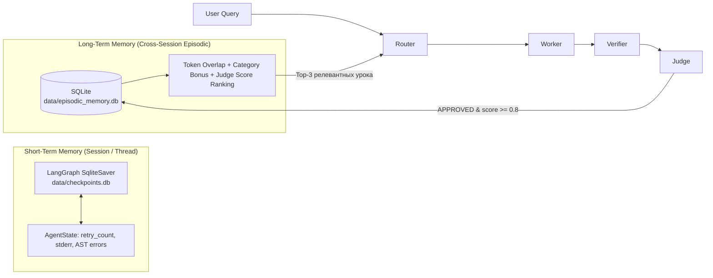

# Архитектурные диаграммы C4 и Sequence Flow

## 1. C1: System Context Diagram

## 2. C2: Container Diagram

## 3. C3: Component Diagram

## 4. C4: Code / Class Diagram

## 5. C4 Deployment Diagram

## 6. C4 Dynamic Diagram — Sequence Flow

## 7. C4 Data & Memory Architecture Diagram

